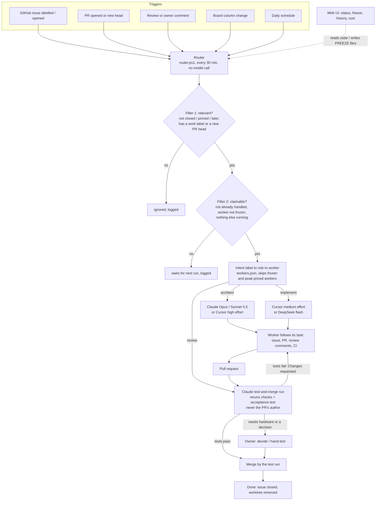

# How the factory works

A **router** watches triggers and filters them twice. Only what survives goes to a **worker**. A worker takes a task, follows everything about it (reviews, CI, comments), finishes it end to end and asks the owner only when a human is needed.

## Intent labels and schedules

Issues are labelled by intent (`architect`, `implement`, `review`), never by worker. The router maps intent to a role, and `workers.json` lists which worker takes each role. The old `cursor` and `deepseek` labels no longer exist.

A worker can also freeze itself on a schedule: DeepSeek is frozen automatically 01:00-04:00 and 06:00-10:00 UTC on weekdays, when its API costs double (Chinese public holidays are off-peak: list them in `offPeakDates`). In Toronto that is 20:00-23:00 (Sun-Thu evenings) and 01:00-05:00 (Mon-Fri) in winter, and one hour later in summer, because the window is fixed in UTC. The UIs show the end time in Toronto time (`displayTimezone`) as "frozen (peak pricing)", separate from a manual freeze.

## Roles and workers

| Role | First choice | Fallback |
|---|---|---|
| architect | Claude (Opus / Sonnet 5.5) | Cursor, high effort |
| implement | Cursor, medium effort | DeepSeek flash |
| review | Cursor, high effort | DeepSeek flash, then Claude Sonnet |

There is no code review step. The worker runs the checks before it opens a PR; the Claude run is the tester: it reruns the checks and the acceptance test on the merged commit and merges what passes. The tester is never the worker that wrote the PR. The `review` label and role names stay because the scripts use them. Frozen workers are skipped, so the next in the list takes the job. The table lives in `workers.json`.

## Migration from `tick`

- `tick.ps1` is now a shim that calls `router.ps1`, so the existing `nuvio-tv-tick` Windows task keeps working unchanged. Nothing to re-register.
- `tick` (bash) still works and calls `router`.
- History lines now start with `router:` instead of `tick:`.
